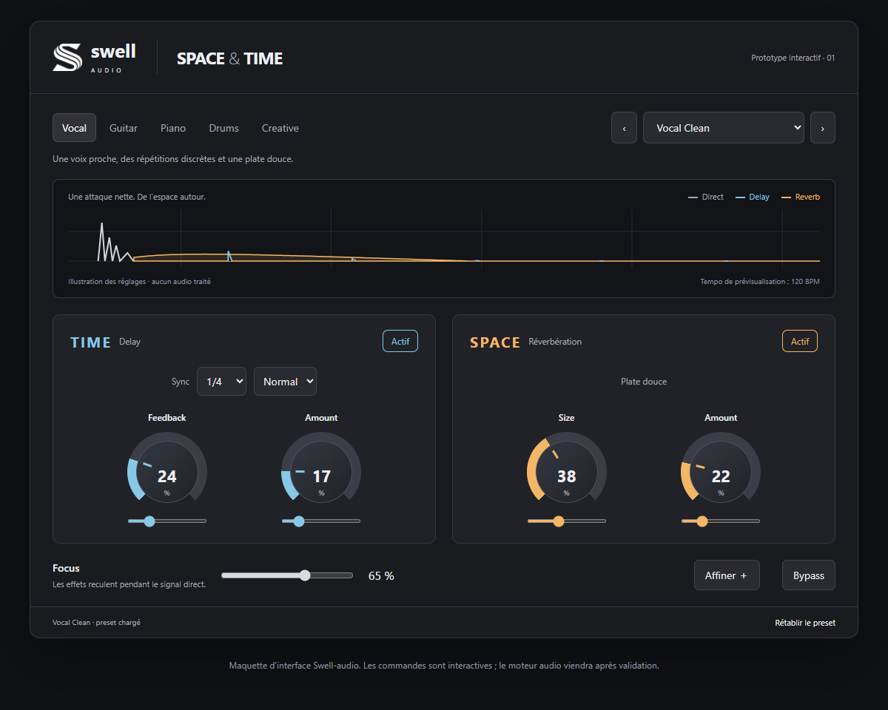

# Swell Space & Time — 0.1.1

Delay synchronisé et réverbération pour voix, guitare, piano et drums.
Première version de travail : à évaluer à l'écoute dans vos sessions.

[Télécharger la version 0.1.1 pour Windows — VST3 et Standalone](https://github.com/sevYOnDaTracks/Swell-Space-and-Time/releases/tag/v0.1.1)

*Aperçu de la maquette initiale. La version native 0.1.1 ajoute le bouton Ping-pong dans TIME ; son affichage audio diffère de cette illustration.*

## Validation Windows

Tests audio et tests Ping-pong réussis, pluginval niveau 5 réussi. Journaux dans Validation. La vérification visuelle manuelle de la version native reste à terminer.

## Installation Windows

Copier le dossier complet `Swell Space and Time.vst3` depuis `Windows` vers
`C:\Program Files\Common Files\VST3`, puis relancer le scan du DAW.
Le Standalone `Swell Space and Time.exe` reçoit une entrée audio : il ne lit pas
les fichiers audio. Choisir l'interface audio dans Options. L'entrée est coupée
par défaut pour éviter les boucles de retour.

## Commandes

- **Ping-pong** dans TIME : la première répétition part à gauche, la suivante
  à droite, puis alterne via Feedback. Fonctionne aussi avec une source mono
  sur une piste stéréo. Width à 0 % recentre les répétitions ; à 100 % elles
  sont séparées gauche/droite. La voix directe ne bouge pas. Une sortie mono
  replie les répétitions au centre. Feedback à zéro donne une seule répétition.
  Le mode est sauvegardé et automatisable ; les presets le réinitialisent sur Off.
  La source stéréo est sommée en mono uniquement pour cet envoi ping-pong.

- **TIME** et **SPACE** s'activent indépendamment. Les presets Drums coupent le delay.
- **Sync** : 1/1, 1/2, 1/4, 1/8, 1/16 ; Normal, Pointé ou Triolet.
  Le tempo du DAW est prioritaire (30–300 BPM). À défaut, le tempo manuel dans
  Affiner est utilisé. Le changement de durée du delay se fait par fondu entre
  deux lectures pour éviter un saut brutal ; une transition reste audible.
- **Feedback** : répétitions, jusqu'à 90 %. **Amount** : niveau de chaque effet.
- **Size** : dimension/durée de la réverbération algorithmique diffuse.
- **Focus** : ducking stéréo lié des effets, jusqu'à 24 dB d'atténuation,
  selon le niveau du signal direct. Attaque 3 ms, relâchement 220 ms.
  Ce contrôle préserve la voix directe, mais ne garantit pas l'intelligibilité
  de toutes les prises avec tous les dosages. Les prises très faibles déclenchent
  moins le ducking. Focus à zéro laisse passer les effets sans ducking.
- **Affiner** : largeur et filtres passe-haut/passe-bas indépendants ; pré-delay
  de la reverb de 0 à 150 ms. Les courbes représentent les réglages des filtres,
  et se règlent par leurs curseurs.
- **Width** : 0 % mono, 100 % stéréo native, jusqu'à 150 % avec normalisation
  pour contenir les crêtes. N'agit que sur les effets ; ne crée pas de stéréo à
  partir de répétitions parfaitement identiques à gauche et à droite.
- **Bypass** : signal direct seul après un bref fondu. **Rétablir le preset**
  recharge ses valeurs. Les paramètres courants et le preset sont sauvés avec la session.

Le signal direct n'est ni filtré, ni élargi, ni atténué. Le delay et la reverb
s'ajoutent en parallèle ; 25 % du delay dosé alimentent aussi la reverb.
Les interrupteurs coupent les effets par un fondu de 40 ms, y compris leur queue.
Les changements de preset conservent les queues internes pour éviter les coupures sèches.
Le graphe affiche un historique de crêtes de sortie, et les indicateurs affichent
la réduction Focus et les crêtes échantillonnées (pas les true peaks).
La somme des effets peut dépasser 0 dBFS : garder de la marge dans le DAW.
Pas de limiteur ni de gain automatique sur la voix directe ; latence déclarée nulle.

## 20 presets

| Famille | Presets |
| --- | --- |
| Vocal | Vocal Clean, Slap, Rap Throw, Wide Chorus, Dreamy |
| Guitar | Acoustic Room, Clean Echo, Dotted Pulse, Ambient Guitar |
| Piano | Natural Room, Warm Hall, Piano Echo, Dreamy Keys |
| Drums | Hi-Hat Air, Snare Impact, Snare Plate, Percussion Room, Drum Ambience |
| Creative | Space Drift, Infinite Clouds |

Ces presets dosent le même moteur algorithmique ; les noms décrivent des intentions
sonores, pas des émulations de salles ou de plaques physiques distinctes.
Infinite Clouds est une longue traîne, pas un gel infini.

## Compilation et formats

JUCE 8.0.6, CMake, Visual Studio 2022 C++ sous Windows : `build.ps1`.
Sur Mac : Xcode, CMake, Git, puis `sh build-mac.sh`.
Windows : VST3 et Standalone x64. Configuration Mac : VST3, AU et Standalone
universels Intel/Apple Silicon ; compilation et validation Mac à effectuer.
VST2 non configuré. Binaires non signés.

JUCE est disponible sous AGPLv3 ou licence commerciale ; une licence adaptée
est nécessaire avant distribution commerciale propriétaire.
